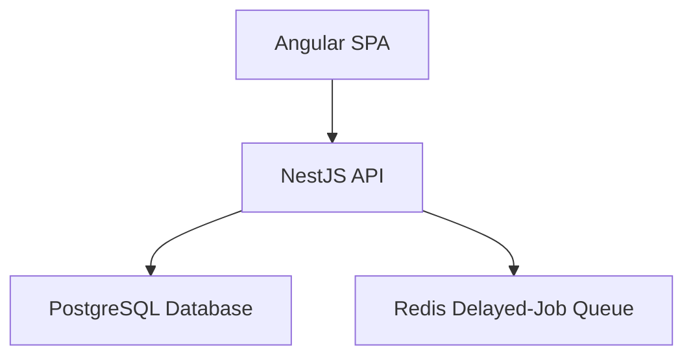
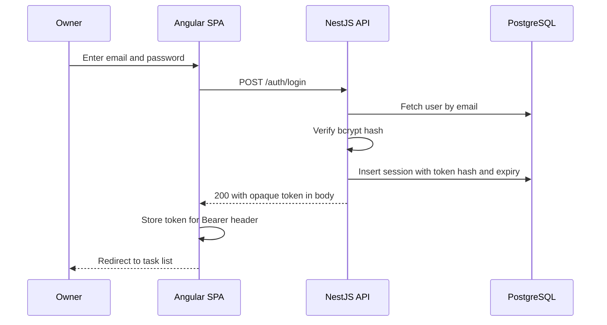
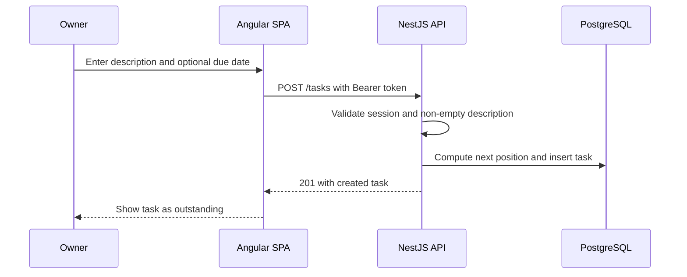
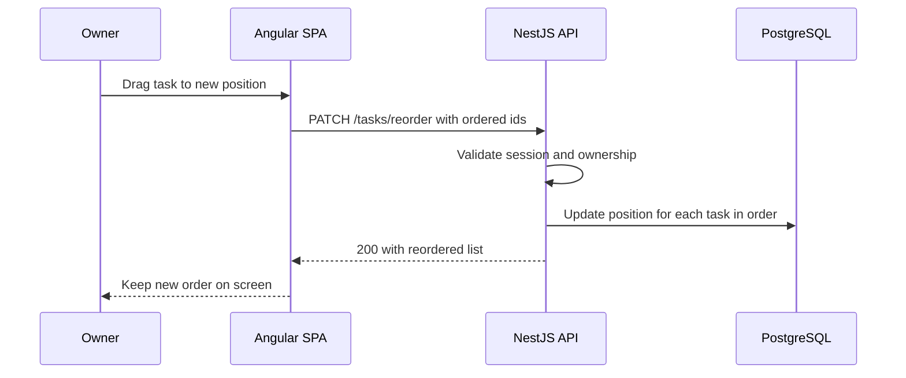
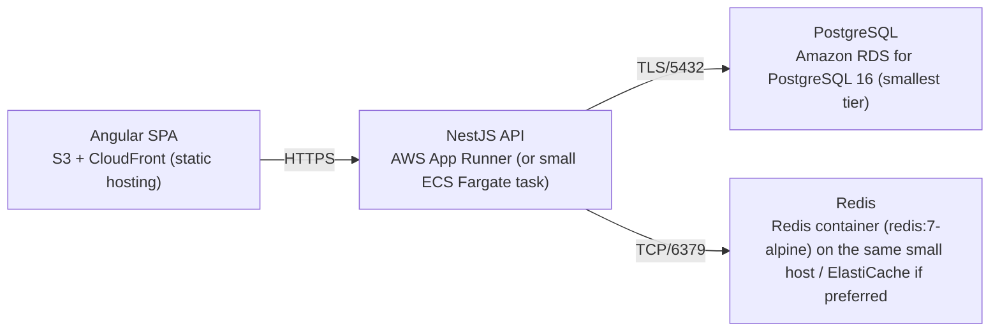

# Architecture

> Maintained by QuorQ AI SDLC. Text between `sdlc:auto` markers is regenerated; anything outside them is yours and is kept.

<!-- sdlc:auto:start narrative -->
## Overview

### ARCH-OVERVIEW · approved · source: architecture:summary

Overall approved architecture (v1) for a lightweight single-user to-do list: Angular 22 SPA + NestJS 11 API + PostgreSQL 16, all on AWS low-cost tiers, with opaque server-side session auth across two origins.

Decision: single-user to-do list delivered as a responsive Angular 22 SPA talking to a NestJS 11 REST API over HTTPS, backed by PostgreSQL 16, deployed on AWS low-cost tiers. SPA and API are on separate origins, so authentication uses server-side sessions with an opaque Bearer token: login returns the token in the response body, Angular stores it and sends Authorization: Bearer on every call, and sign-out or inactivity expiry revokes it server-side. Scope: owner manages one flat list of tasks (add, edit, due date/time, complete/reopen, delete, drag-to-reorder) with outstanding and completed views; due dates render in the owner's own time zone. A Redis queue is provisioned per the approved stack for timed reminders, but reminder message delivery (email, push, SMS) is explicitly out of scope in this version. Status: approved, version 1.

### ARCH-COMP-WEB · approved · source: architecture:component:web

Angular 22 responsive SPA is the single-user interface for sign-in, task CRUD, completion state, reordering, and viewing outstanding vs completed tasks.

Component: web (Angular SPA, Angular 22). Responsibilities: responsive single-user UI for sign-in, task CRUD, complete/reopen, drag-to-reorder, and outstanding vs completed views; stores the opaque session token and sends it as a Bearer Authorization header on requests; renders due dates in the owner's time zone.

**Related:** ARCH-TECH-FRONTEND

### ARCH-COMP-API · approved · source: architecture:component:api

NestJS 11 REST API handles authentication, task management, ordering, and completion state, enforcing that only the signed-in owner can reach their own tasks.

Component: api (NestJS API, NestJS 11). Responsibilities: REST API for authentication (opaque server-side sessions), task management, ordering, and completion state; hashes passwords; validates input; enforces that only the signed-in owner reaches their tasks.

**Related:** ARCH-TECH-BACKEND

### ARCH-COMP-DB · approved · source: architecture:component:db

PostgreSQL 16 is the durable store for the single user account, sessions, and the flat task list.

Component: db (PostgreSQL Database, PostgreSQL 16). Responsibilities: durable store for the single user account, sessions, and the flat task list with due dates, completion flag, and ordering position.

**Related:** ARCH-TECH-DB, ARCH-DATA-MODEL

### ARCH-COMP-QUEUE · approved · source: architecture:component:queue

A Redis delayed-job queue is provisioned to hold timed reminder jobs, but actual reminder delivery is out of scope in this version.

Component: queue (Redis Delayed-Job Queue, Redis redis:7-alpine). Responsibility: holds delayed reminder jobs until each task's send time (infrastructure provisioned per approved stack). Explicitly out of scope in this version: actual reminder message delivery, since all notification channels (email, push, SMS) are out of scope.

### ARCH-DATA-MODEL · approved · source: architecture:entities

Three entities back the system: users, sessions, and tasks, covering account, session, and task state including ordering position.

users: id, email, password_hash, timezone, created_at.
sessions: id, user_id, token_hash, expires_at, last_active_at, created_at.
tasks: id, user_id, description, due_at, is_complete, position, created_at, updated_at.

### ARCH-ENDPOINTS · approved · source: architecture:endpoints

The API exposes auth endpoints (login, logout, current-user check) and task endpoints covering list/create/edit/complete/reorder/delete.

POST /auth/login - authenticate with email and password; on success create a server-side session and return an opaque token in the body.
POST /auth/logout - revoke the current session so the token can no longer be used.
GET /auth/me - return the signed-in owner's profile; used by the SPA to confirm an active session and redirect to sign-in when absent.
GET /tasks - list the owner's tasks, optionally filtered by status, ordered by position.
POST /tasks - create a task with a required description and optional due date/time; appended to the end of the list as outstanding.
PATCH /tasks/:id - edit a task's description and/or due date/time; rejects an empty description.
PATCH /tasks/:id/completion - mark a task complete or reopen it.
PATCH /tasks/reorder - persist a new ordering of outstanding tasks from the drag-and-drop interaction.
DELETE /tasks/:id - delete a task so it no longer appears in any view.

**Related:** ARCH-COMP-API

### ARCH-PATH-LOGIN · approved · source: architecture:critical_path:sign_in

Critical path for signing in and establishing a session using bcrypt verification and a server-side session row.

Owner submits email and password; API verifies the bcrypt hash, creates a server-side session row, and returns an opaque token in the response body which the SPA stores and attaches to subsequent requests as a Bearer header.

**Related:** ARCH-COMP-API, ARCH-COMP-WEB, ARCH-DATA-MODEL

### ARCH-PATH-ADD-TASK · approved · source: architecture:critical_path:add_task

Critical path for adding a task, including validation and ordering position assignment.

Signed-in owner submits a description and optional due date/time; API validates a non-empty description, assigns the next ordering position, and persists the task as outstanding.

**Related:** ARCH-COMP-API, ARCH-DATA-MODEL

### ARCH-PATH-REORDER · approved · source: architecture:critical_path:reorder

Critical path for drag-to-reorder of outstanding tasks, persisting the new order so it survives a reload.

Owner drags a task to a new position; the SPA sends the new ordered list of task ids and the API persists the updated positions so the order survives a reload.

**Related:** ARCH-COMP-API, ARCH-COMP-WEB, ARCH-DATA-MODEL

### ARCH-DEPLOYMENT · approved · source: architecture:deployment_nodes

All components deploy on AWS low-cost tiers: static SPA via S3/CloudFront, API via App Runner or small Fargate, PostgreSQL via smallest RDS tier, Redis as a small container or ElastiCache.

Angular SPA: S3 + CloudFront (static hosting) serving the built Angular 22 bundle as static assets.
NestJS API: AWS App Runner (or small ECS Fargate task) running Node.js (NestJS 11).
PostgreSQL: Amazon RDS for PostgreSQL 16, smallest tier.
Redis: Redis container (redis:7-alpine) on the same small host, or ElastiCache if preferred, Redis 7.

**Related:** ARCH-TECH-CLOUD

### ARCH-TECH-FRONTEND · approved · source: architecture:tech_decision:frontend

Angular 22 approved as the frontend stack over React and Vue alternatives, for its CDK drag-and-drop support and static hosting fit.

Decision: Angular 22 (alternatives considered: React, Vue). Approved stack. Rationale: delivers the responsive single-user UI; Angular CDK provides accessible drag-and-drop for reordering; the built SPA is served statically from CloudFront on a separate origin from the API.

**Related:** ARCH-COMP-WEB

### ARCH-TECH-BACKEND · approved · source: architecture:tech_decision:backend

NestJS 11 approved as the backend stack over Express and Fastify alternatives, structuring auth, task, and ordering logic with guards.

Decision: NestJS 11 (alternatives considered: Express, Fastify). Approved stack. Rationale: structured modules host the auth (opaque session), task, and ordering logic; guards enforce the Bearer-token session on every protected route and keep the owner's list private.

**Related:** ARCH-COMP-API

### ARCH-TECH-DB · approved · source: architecture:tech_decision:database

PostgreSQL 16 approved as the database over MySQL and SQLite alternatives, for relational fit and efficient due-date queries.

Decision: PostgreSQL 16 (alternatives considered: MySQL, SQLite). Approved stack. Rationale: relational store fits the structured, date-driven task data and answers 'which tasks are due soon' efficiently via indexed timestamptz columns.

**Related:** ARCH-COMP-DB, ARCH-DATA-MODEL

### ARCH-TECH-CLOUD · approved · source: architecture:tech_decision:cloud

AWS approved as the cloud provider over Fly.io and Render alternatives, running all components comfortably on smallest tiers.

Decision: AWS (alternatives considered: Fly.io, Render). Approved stack. Rationale: runs the static SPA (S3/CloudFront), the API (App Runner/Fargate), PostgreSQL (RDS), and the Redis container comfortably on smallest tiers.

**Related:** ARCH-DEPLOYMENT
<!-- sdlc:auto:end narrative -->

<!-- sdlc:auto:start building-blocks -->
## Building Block View

| ID | Name | Technology | Responsibility | Depends on |
|---|---|---|---|---|
| web | Angular SPA | Angular 22 | Responsive single-user UI for sign-in, task CRUD, complete/reopen, drag-to-reorder, and outstanding vs completed views; stores the opaque session token and sends it as a Bearer header; renders due dates in the owner's time zone. | api |
| api | NestJS API | NestJS 11 | REST API for authentication (opaque server-side sessions), task management, ordering, and completion state; hashes passwords, validates input, and enforces that only the signed-in owner reaches their tasks. | db, queue |
| db | PostgreSQL Database | PostgreSQL 16 | Durable store for the single user account, sessions, and the flat task list with due dates, completion flag, and ordering position. | — |
| queue | Redis Delayed-Job Queue | Redis (redis:7-alpine) | Holds delayed reminder jobs until each task's send time (infrastructure provisioned per approved stack); actual reminder message delivery is out of scope in this version as all notification channels are out of scope. | — |

<!-- sdlc:auto:end building-blocks -->

<!-- sdlc:auto:start runtime -->
## Runtime View

### Sign in and establish a session

Owner submits email and password; API verifies the bcrypt hash, creates a server-side session row, and returns an opaque token in the response body which the SPA stores and attaches to subsequent requests.

- **Components:** web, api, db
- **Modules:** AuthController, AuthService, SessionService, UserRepository
- **Key functions:** login(email, password), verifyPassword(hash, plain), createSession(userId), issueOpaqueToken()

### Add a task

Signed-in owner submits a description and optional due date/time; API validates a non-empty description, assigns the next ordering position, and persists the task as outstanding.

- **Components:** web, api, db
- **Modules:** TaskController, TaskService, TaskRepository, SessionGuard
- **Key functions:** createTask(userId, description, dueAt), validateDescription(description), nextPosition(userId)

### Reorder outstanding tasks

Owner drags a task to a new position; the SPA sends the new ordered list of task ids and the API persists the updated positions so the order survives a reload.

- **Components:** web, api, db
- **Modules:** TaskController, TaskService, TaskRepository
- **Key functions:** reorderTasks(userId, orderedTaskIds), applyPositions(userId, orderedTaskIds)

<!-- sdlc:auto:end runtime -->

<!-- sdlc:auto:start deployment-view -->
## Deployment View

| Name | Service | Runtime | Scaling | Environment |
|---|---|---|---|---|
| Angular SPA | S3 + CloudFront (static hosting) | Static assets (built Angular 22 bundle) | CDN-served, single build | dev |
| NestJS API | AWS App Runner (or small ECS Fargate task) | Node.js (NestJS 11) | Single small instance, scale-out available | dev |
| PostgreSQL | Amazon RDS for PostgreSQL 16 (smallest tier) | PostgreSQL 16 | Single low-cost instance | dev |
| Redis | Redis container (redis:7-alpine) on the same small host / ElastiCache if preferred | Redis 7 | Single node | dev |

| Source | Target | Protocol |
|---|---|---|
| Angular SPA | NestJS API | HTTPS |
| NestJS API | PostgreSQL | TLS/5432 |
| NestJS API | Redis | TCP/6379 |

<!-- sdlc:auto:end deployment-view -->

<!-- sdlc:auto:start decisions -->
## Architecture Decisions

| Layer | Choice | ADR |
|---|---|---|
| Frontend | Angular 22 | [ADR-0001](adr/frontend.md) |
| Backend | NestJS 11 | [ADR-0002](adr/backend.md) |
| Database | PostgreSQL 16 | [ADR-0003](adr/database.md) |
| Cloud | AWS | [ADR-0004](adr/cloud.md) |
<!-- sdlc:auto:end decisions -->

<!-- sdlc:auto:start links -->
## Related Documents

- [Data Model](data-model.md)
- [API Specification](api/openapi.yaml)
- [Architecture Decision Records](adr/README.md)
<!-- sdlc:auto:end links -->
