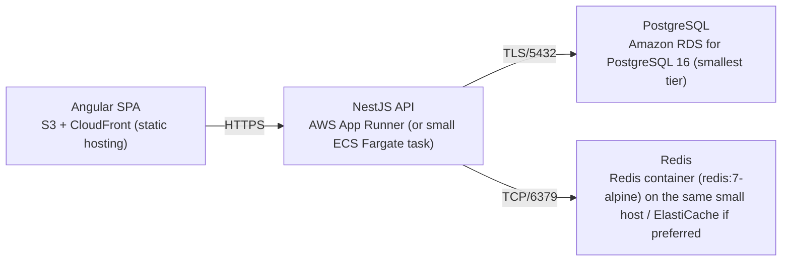

# Deployment Guide

> Maintained by QuorQ AI SDLC. Text between `sdlc:auto` markers is regenerated; anything outside them is yours and is kept.

<!-- sdlc:auto:start how-it-deploys -->
Pushes to `main` run `.github/workflows/deploy.yml`, which builds the API image (if there is a backend) and deploys the SPA to AWS Amplify. Commits touching only `docs/sdlc/**` don't deploy. Deployments can also be started from the platform's Deployment tab.
<!-- sdlc:auto:end how-it-deploys -->

<!-- sdlc:auto:start environments -->
| Name | Service | Runtime | Scaling | Environment |
|---|---|---|---|---|
| Angular SPA | S3 + CloudFront (static hosting) | Static assets (built Angular 22 bundle) | CDN-served, single build | dev |
| NestJS API | AWS App Runner (or small ECS Fargate task) | Node.js (NestJS 11) | Single small instance, scale-out available | dev |
| PostgreSQL | Amazon RDS for PostgreSQL 16 (smallest tier) | PostgreSQL 16 | Single low-cost instance | dev |
| Redis | Redis container (redis:7-alpine) on the same small host / ElastiCache if preferred | Redis 7 | Single node | dev |
<!-- sdlc:auto:end environments -->

<!-- sdlc:auto:start live -->
_Not deployed yet._
<!-- sdlc:auto:end live -->

<!-- sdlc:auto:start topology -->

<!-- sdlc:auto:end topology -->
